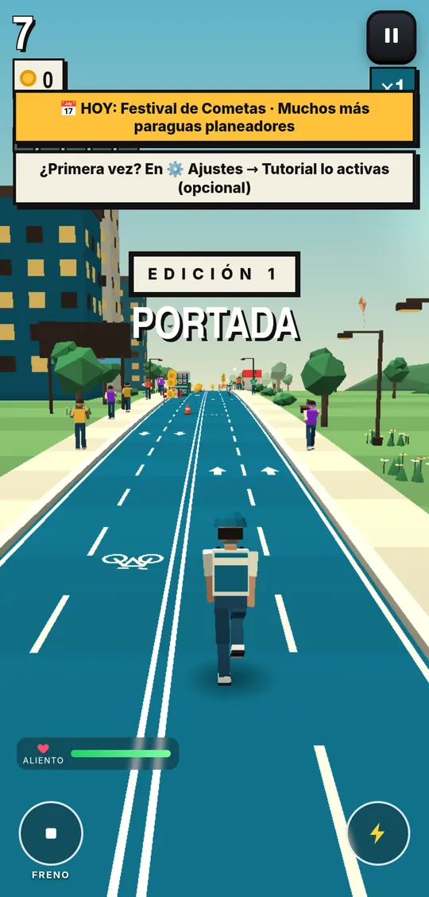
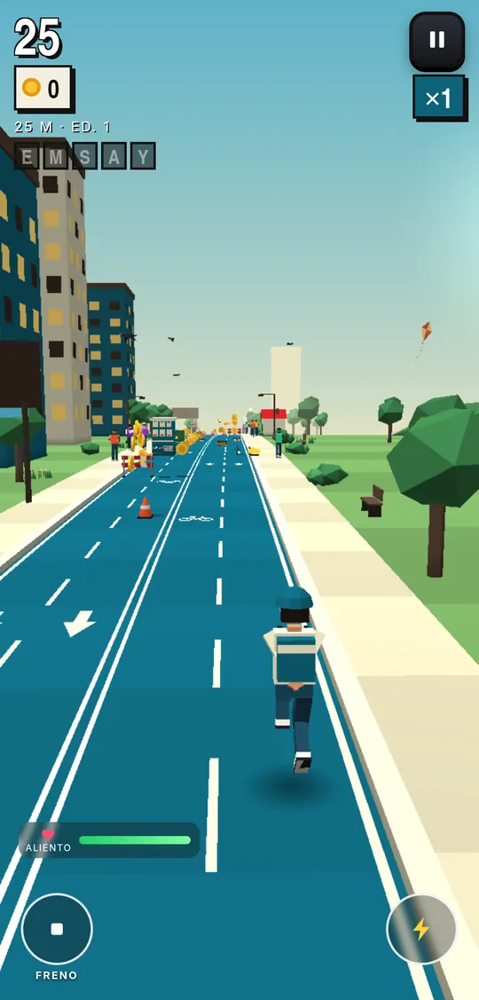
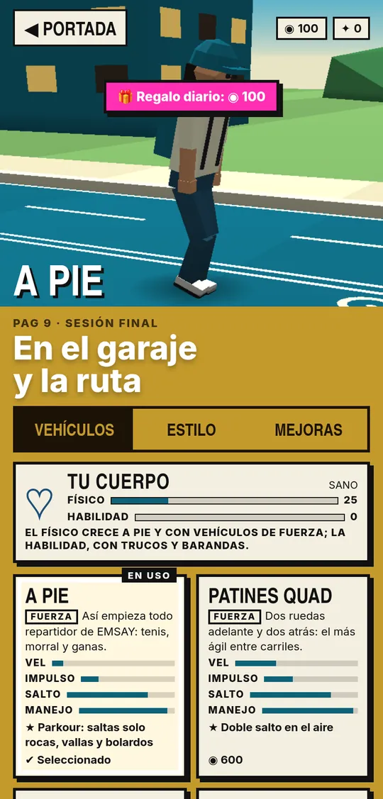

# Auditoría crítica y forense · Run Scooter (`RunRunZero` v2.5.0 y su copia en Motor City)

> **Fecha:** 27-nov-2026 · **Informe completo del ecosistema (los 5 productos):** [`motorcity/docs/AUDITORIA-CRITICA-2026-11-27.md`](https://github.com/juanfeliperico369-stack/motorcity/blob/main/docs/AUDITORIA-CRITICA-2026-11-27.md)
>
> **Metodología:** revisión completa de los 13 archivos de `src/`, `tools/`, `web/index.html`, `motorcity/js/50-run.js` y ejecución real en Google Chrome 158 móvil (`412 × 860`, DPR 2, táctil, WebGL).

---

## 1. Evidencia visual real (`412 × 860`, v2.5.0)

Lo que salta a la vista al abrir el juego hoy:
1. **Portada rota y saturada (`run-scooter-portada.webp`):** **12 botones amontonados** (8 miden `42 px` de alto, violando el mínimo de `44 px`; 2 salen cortados abajo), ahogando la ventana 3D a un resquicio, y el aviso rosa `🎁 Regalo diario: ◉ 100` **aparece pegado detrás de las letras `RUN`** (y en `run-scooter-garaje.webp` tapa la cara del personaje).
2. **Arranque ilegible (`run-scooter-juego.webp`):** al empezar a correr, **tres carteles simultáneos** (`HOY: Festival de Cometas`, `¿Primera vez?...`, `EDICIÓN 1 / PORTADA`) tapan el multiplicador `×1`, las letras `E M S A Y`, la distancia y toda la mitad superior de la pista.
3. **Vallas en blanco (`run-scooter-juego.webp` y `run-scooter-accion.webp`, lado izquierdo):** TODAS las vallas de la ciudad se ven como **rectángulos marrón oscuro vacíos** porque el marco opaco del modelo tapa su propio arte.
4. **Estética barata y dentada (`run-scooter-accion.webp`):** asfalto plano azul petróleo sin textura, bordes serruchados (`antialias: false`), edificios de cajas con cuadrados planos, cero sombras en edificios/árboles/peatones y ruedas completamente estáticas.

---

## 2. Dónde falla técnicamente (evidencia línea por línea)

### 2.1 Bugs visuales graves en WebGL (`src/models.js`, `src/engine.js`, `src/render.js`)
1. **100 % de las vallas publicitarias tapadas por su respaldo (`src/models.js:121-123`):**
   - `billFrame()` dibuja el tablero opaco en `z = 0.06` con profundidad `0.12` (`z ∈ [0.00, +0.12]`), mientras `billPanel()` / `billPanelUV()` dibujan la imagen de EMSAY en **`z = 0.00`**. Como la cámara mira desde `+z` hacia `-z`, el respaldo tapa por completo las 14 vallas del atlas.
2. **Montañas de 30 metros que se mecen con el viento y pierden la nieve (`src/engine.js:119`, `src/models.js:288`):**
   - El shader de viento de árboles mueve todo vértice con `uPal > 0.5 && aC.r < 0.06 && aP.y > 0.9` por `0.045 * aP.y`. `MOD.mount()` usa `PC(0)` (`aC.r = 0`) hasta `y = 29 m` (se mece `±1,3 m`), mientras la cumbre nevada usa `PC(3)` (`aC.r = 0.75`) y se queda quieta flotando en el aire.
3. **Letrero equivocado en andamios (`src/models.js:347, 61`):** `scaff()` mapea `ATR.sign[7]` = `"KIOSCO EMSAY · LAS NUEVAS NUEVAS"`.
4. **Iluminación invertida en casas/buzones del lado izquierdo (`src/render.js:325`, `src/engine.js:120,126`):** espeja con escala negativa `kx = -1` sin matriz normal.
5. **Desperdicio de GPU y GC cada cuadro:**
   - **354 a 500 *draw calls* sin instanciado** (`gl.drawArrays` no indexado, sin `CULL_FACE`, sin mipmaps, `antialias: false`).
   - `src/render.js:228` crea un arreglo nuevo `[sc.sh, sc.sh, sc.sh]` por cada objeto de escenario cada cuadro, rompiendo la caché `this._tint !== tint` de `engine.js:238`.
   - Ruedas horneadas estáticamente en la malla de todos los vehículos (`models.js:191-238`, `models2.js:46-103`): **ninguna rueda gira**.

### 2.2 Bugs críticos de jugabilidad, controles y audio (`src/game.js`, `src/main.js`, `src/audio.js`, `src/ui.js`)
1. **Trampa mortal anti-buffering y cero *coyote time* (`src/game.js:443-448, 606, 615`):**
   - No existe *coyote time* al caer de rampas/camiones ni búfer de salto.
   - Si deslizas `↑` apenas 50–150 ms antes de aterrizar (memoria muscular estándar de *Subway Surfers*), en 15 de los 17 vehículos `game.js:448` dispara un truco aéreo que, al tocar suelo `<0,22 s` después (`game.js:606`), **te hace tropezar o te mata por «truco incompleto»**.
2. **Hielo silencioso que hace creer que se rompió el táctil (`src/game.js:440, 658`):**
   - Pisar hielo bloquea `L`/`R` por `1,1 s`, pero **nadie escucha los eventos `'ice'` ni `'slip'`** en `main.js`, `audio.js`, `render.js` ni `ui.js`. Cero sonido, cero partículas, cero aviso: el giro simplemente muere por 30 metros.
3. **Hitbox idéntico de peatón para los 17 vehículos (`src/game.js:4, 625, 640`):**
   - El camión de 4,43 m (`camion`) usa el mismo hitbox `0,64 × 0,64 × 1,7 m` que ir a pie: se agacha bajo andamios sin animación (`render.js:110-111`), salta 1,4 m y muere en volteretas invisibles.
4. **Tráfico fantasma que crea muros de 4 carriles imposibles (`src/game.js:174-184, 629-633`):** los carros y ciclistas en movimiento atraviesan camiones y muros estáticos sin chocar y pueden alinearse con una fila de 3 obstáculos creando un muro insalvable que `g.bad` no detecta.
5. **Otros bugs verificados:**
   - **P8 incumplido:** `RunRunZero` **no tiene `01-sonido-guardian.js`** (aunque tiene 50 MB muertos de `motor-city/` en el repo!); `main.js:305` solo escucha `visibilitychange` y `AU.music` deja su `setInterval` corriendo.
   - **Fuga de memoria en `g.forks` (`src/game.js:719-729`):** nunca se limpia del arreglo si no giras en esquina.
   - **Desincronización de perk en HUD (`ui.js:254-255` vs `game.js:421,424`):** `brazo` de Doña Correo amplía el alcance a 28 m en lógica pero el HUD sigue en 22 m.
   - **`fastFall` atascado bajo paraguas (`game.js:457,600,605`):** deslizar `↓` planeando te fuerza a agacharte segundos después al aterrizar.
   - **Multitouch roto (`main.js:289`):** un segundo dedo sobrescribe `sw` del primer dedo.
   - **Reflows forzados en juego (`ui.js:267`, `main.js:347`):** `void el.offsetWidth` en pleno bucle.
   - **50 MB de peso muerto (97,5 % del repo):** `RunRunZero/motor-city/` no se usa en absoluto; `src/` lleva **18 commits** sin un solo arreglo (el plan entero de arreglos en `docs/coordinacion/estado-antigravity.json` nunca se ejecutó).

### 2.3 La integración dentro de Motor City (`motorcity/js/50-run.js`) está aún más rota
- *Swipes* disparan solo en `pointerup` (`50-run.js:70`, +80–150 ms de lag) y cualquier toque corto salta.
- **HUD ciego:** corren perros, policía, semáforos en rojo, animales, entregas y combos, pero el HUD no muestra ninguno.
- **Bucle infinito de muerte (`50-run.js:82-83`):** al acabarse la ciclorruta, el botón «Seguir corriendo» revive al jugador solo para volver a matarlo en el siguiente cuadro para siempre.
- **Cambio de vehículo corrupto (`50-run.js:64`):** deja a un carro haciendo *parkour* o le quita el salto a un corredor.
- **Música trabada:** nunca enciende `AU.inPlay`, dejando el bucle de 116 BPM pegado para siempre.

---

## 3. Por qué NO es divertido (crítica de diseño) y qué omiten las pruebas

- **Paradoja:** Run Scooter es el juego más limpio y ligero del ecosistema (**469 KB**, **11,1 MB RAM**), pero **se sabotea a sí mismo en los primeros 15 segundos**: portada saturada, 3 carteles tapando el arranque, vallas rotas, controles que matan por pre-saltar, hielo mudo y 17 vehículos que se sienten como rieles idénticos sin peso, *hitstop* ni ruedas giratorias.
- **Historia hueca (`src/story.js`):** 100 de las 112 páginas son relleno genérico de trivia desconectado de la partida, y el villano («La Tinta Gris») fue borrado del juego aunque su malla (`MOD.ink`) siga subiéndose a VRAM y su clímax siga en los textos.
- **Pruebas ciegas (`tools/sim.mjs`, `tools/bot.mjs`, `tools/verify.mjs`):** `sim.mjs` nunca carga `models.js`, `render.js`, `audio.js`, `ui.js` ni `main.js`, usa un bot omnisciente (jamás prueba *swipes*, *coyote time* ni trucos) y no vigila `g.forks`; `bot.mjs` navega por código sin tocar botones reales, usa `autoplay`, ignora 12 de 17 vehículos y jamás valida FPS, `drawsMax`, audio ni solapamientos.

---

## 4. Hoja de ruta realista: Run Scooter puede ser tu PRIMER juego realmente bueno

A diferencia de los otros tres proyectos (que cargan 10–30 MB y 80–100 archivos de parches), **Run Scooter se puede rescatar y pulir de verdad en 1–2 semanas**:

1. **Arreglos quirúrgicos de 1 día (impacto inmediato):**
   - Mueve el respaldo de `billFrame()` (`models.js:121`) detrás de `billPanel()` (`z = -0.06`) para que todas las vallas aparezcan.
   - Excluye `mount`/`hill` del shader de viento (`engine.js:119`).
   - Integra `01-sonido-guardian.js` (P8) y borra los **50 MB** muertos de `motor-city/`.
   - Cola FIFO de **1 solo aviso a la vez** arriba del HUD (nunca 3 carteles apilados ni toast detrás del título `RUN`).
   - Limpia `g.forks` en `game.js:719`, arregla el `brazo` en `ui.js:254`, limpia `fastFall` durante planeo y protege `sw` contra multitouch.
2. ***Game feel* real (aplicar tu propia skill `run-scooter-game-feel`, hoy 0 % cumplida):**
   - **Coyote time (120 ms)** + **búfer de salto/agacharse (140 ms)**, y **jamás matar por truco incompleto al pre-saltar** (los trucos solo se activan si ya estás subiendo/alto, o con toque deliberado en el aire).
   - **Hitstop (50 ms)** al romper escudo o rozar obstáculos + cámara con resorte independiente de FPS (`1 - Math.exp(-k * dt)`) + ruedas giratorias + feedback visual/sonoro inmediato en hielo y *near-miss*.
   - **Hitboxes por clase de vehículo** (peatón/patín vs. bici/moto vs. auto/camión) y eliminar el tráfico fantasma que atraviesa obstáculos.
3. **Limpieza visual y de portada:**
   - Reduce la portada a **3 botones claros** (`▶ REPARTIR`, `🛴 GARAJE`, `★ RETO`) dejando la vista 3D viva respirando.
   - Añade texturas ligeras en el atlas para asfalto, andenes y fachadas, activa `CULL_FACE` y mipmaps, y elimina el `[sc.sh, sc.sh, sc.sh]` por cuadro en `render.js:228`.
   - Arregla o desconecta `motorcity/js/50-run.js` hasta que tenga paridad de HUD, *swipes* en `pointermove` y no entre en bucle de muerte.
